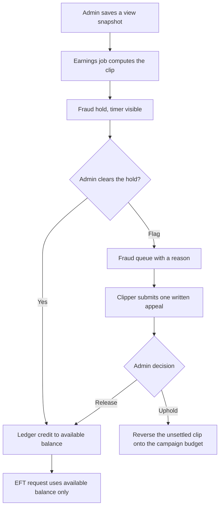
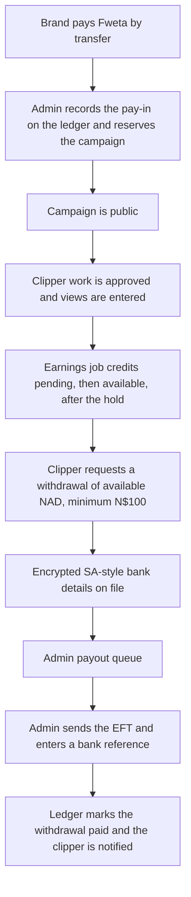
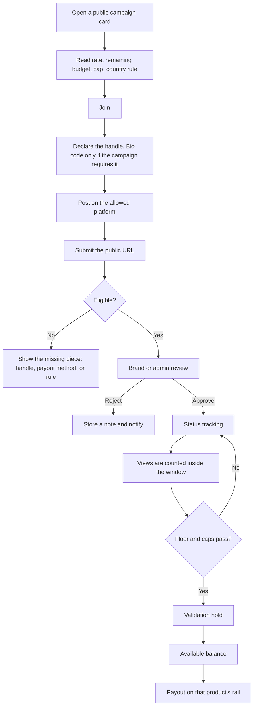
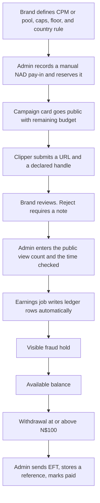

# Competitor feature mechanics

Public-page reverse engineering for Fweta, observed on **17 October 2026**. This note explains how the working features of the main clipping products actually operate: the steps, the states, the data each step needs, and the money and fraud rules. It sits next to [competitor-teardown.md](./competitor-teardown.md). That earlier note is the survey. This one is the mechanism.

Nothing here is copied product copy, source, or branding. Numbers are what a public page stated that day. Where a marketing page and a legal page disagree, both are recorded.

## How this was observed

REA `6.5.0` opened a temporary Chrome profile (`capture-browser-scenario`, launch mode, no stored login) and recorded the accessibility tree. A second pass recorded network metadata for about five seconds after load: method, status, resource type, host, and path. Request bodies, response bodies, and header values were not captured, so this report does not reproduce API payloads or script source.

**Observed** means the page or the network log showed it. **Inferred** means the public surface implies it, and the inference is labeled in the sentence.

**Could not be read**

- ClipAffiliates (`clipaffiliates.com`, `www`, docs, help, and app hosts) did not serve a product. Cloudflare error 1000, a host placeholder, or a timeout. Nothing below is a ClipAffiliates fact. A FindClout article about the category is not used as evidence for any other company.
- Reddit blocked this network. Complaints stay on Trustpilot and on the platforms' own help and terms.
- Promote campaign detail did not render. The homepage board did.
- `whop.com` and `whop.com/discover` did not expose a Content Rewards campaign catalog in the capture window. Content Rewards mechanics come from `contentrewards.com`.
- Logged-in brand queues, admin payout desks, and in-app notification centers were not opened. Where a help page describes them, that description is observed. Where this note fills a gap behind login, it is inferred.

## Fweta constraints used in every implementation note

These override whatever rail the competitor uses.

- An admin types view counts for now. The earnings job still calculates pay from those counts and writes ledger rows. The card shows when the count was last checked, so a manual entry does not look like a stalled tracker.
- Brand money arrives as a recorded manual pay-in. Creator money leaves as a manual South African-style EFT. There is no card gateway, no wallet rail, and no crypto requirement in this version.
- Currency is NAD. Minimum withdrawal is N$100. Bank fields stay the existing set: bank name, 6-digit branch code, account number, account holder, and cheque, savings, or transmission. Bank details stay encrypted and are never logged.
- Country targeting defaults to Namibia and the rest of SADC, and the rule is visible on the campaign.
- A balance never changes without a matching ledger entry.

---

## 1. Onboarding and account ownership

### What the public products do

**Content Rewards (observed, terms and privacy).** The creator is 18 or older. A social account is linked in one of two ways: a read-only official connection (OAuth, including TikTok Login Kit or the TikTok Business API, plus YouTube, Instagram professional, a Facebook Page the person administers, and X), or a verification code placed in the bio where that option is offered. The connection is read-only. The platform does not post for the creator. Some campaigns require a connected account before a submission is accepted. Collected fields are the public profile and performance: handle, follower counts, views, engagement, and, when the permission allows it, audience country, age group, gender, and watch time. That audience slice is shared with the organization running the campaign. Existing links can be forced onto OAuth with at least two weeks' notice. Tracking and payouts can pause if the deadline is missed. New campaigns run on contentrewards.com. Some older ones still run inside a Whop-hosted experience. Sign-in for launching a campaign is described as a Whop sign-in.

**Clipping.net (observed, clipper docs).** Login is Discord. Adding a social account takes a platform and a handle, then a 5-digit code pasted into the bio. The creator clicks that the code is in place. The site checks the public profile. States on the account row: **Verified** (green), **Pending** (orange), **Error** (red), **Expired** (orange clock). Several accounts per platform are allowed. Each has its own code. On submit, the site picks which connected account owns the URL. Deleting an account stops new tracking. Earnings already recorded stay. After verification the code can be removed from the bio.

**ClipStake (observed, terms and creator page).** Waitlist, then a wallet connection (Privy, Phantom, or MetaMask). The creator page says there is no follower minimum in general, while a public campaign page required 1,000 followers for geo-targeted campaigns. View checks are a guided open of the post's analytics page. The creator page says that check does not grant account access.

**Vyro (observed, marketing and help).** Connect the social account, download the source, post, submit the URL. No follower minimum is stated.

**Vues (observed, marketing).** Apply, then get approved, then post. No follower minimum is stated. The iOS page describes submit from the phone share sheet and batch paste.

**Reach.cat (observed, onboarding page and terms).** The onboarding page says no application and no ID to start, and a wallet such as Phantom is enough. The terms are stricter: one account per person, and accounts younger than 30 days cannot join a public campaign during its first 7 days. A flagged account can be required to pass identity checks before joining. Invited campaigns are exempt from that age rule.

**FindClout (observed, clipper page).** Discord is the front door, then an app. Audience is limited to pages that reach the US, UK, Canada, or Australia. A Telegram bot is described as editing and posting for the clipper. That is a closed roster, not an open board.

**Promote (observed, homepage).** Connect TikTok, Instagram, YouTube, or X without handing over the social password, then join.

**SideShift (observed, plans and product pages).** This is a hiring product. The brand invites or sources creators inside plan limits. It is not an open clip application.

**Inferred.** Bio-code checks work by reading the public profile HTML or a public profile API and looking for the code. OAuth checks work by comparing the submitted URL's author id with the connected account id. Neither request was visible without a login, so the exact match rule is inferred from the documented outcome ("auto-detects which account").

### Data each step needs

| Step | Data |
| --- | --- |
| Create account | Email or Discord identity, age confirmation, country |
| Link a social | Platform, handle, and either an OAuth grant or a one-time public code |
| Become eligible to submit | Verified handle, a payout method on file, and any campaign-specific audience or follower rule |
| Submit | Public URL whose author matches a verified handle |

### How Fweta should implement it

Signup stays email and password. Do not block signup on a social connection or a wallet.

For this version, ownership is a declaration plus a later check:

1. The clipper picks the platform and types the public handle.
2. On submit, they paste the public URL and confirm that the handle on the URL is theirs.
3. The submission stores platform, handle, URL, and the time of the declaration.
4. If a campaign is sensitive, an admin can require a bio code before approval. The admin generates a short code, the clipper places it on the public profile, and the admin confirms it is visible, then marks the handle **verified**. States: declared, code issued, verified, check failed.
5. A URL whose handle does not match a declared handle for that user is rejected with a note.

Identity documents are collected at the first EFT request, not at signup. Store only what the payout desk needs to pay and to meet POPIA. Do not collect audience age or gender until a social API exists, and do not show that data to a brand until the clipper has agreed.

---

## 2. Campaign cards and discovery

### What a visitor can see without joining

**Content Rewards discover (observed).** The board is a public catalog. A hero carousel, a "most searched" rank with 24h / 7d / 30d toggles, a trending list, and a top-clips region. A card shows the organization, a verified badge, category, platform icons, rate per 1,000 views, budget spent and budget total, creator count, and age. A live campaign page added, per platform: rate per 1,000, a minimum payout, and a maximum payout. The example page showed $1.00 per 1,000, a $10 minimum, and a $500 maximum, on a budget with a spent figure and a remaining figure. Requirements and reference files were counted in the open page and locked until join ("join to unlock"). The top-clipper block showed a creator count and rank medals, and withheld names and view totals until join.

**ClipStake marketplace (observed).** A public list, then a public campaign page with no login: status (Active), created date, platforms, end date, total views, a views goal and remaining views, a "botted views prevented" label, submission steps, resource links, a total budget, CPM, minimum views, maximum payout, and a paginated leaderboard. The botted-views number itself was not in the accessibility text.

**Vyro and Vues campaign indexes (observed).** Campaign cards are server-rendered pages. The network log showed HTML prefetches of campaign URLs, not a separate public JSON list. Vues org pages show live counts and paid-out totals. Exact live CPMs on Vues sit behind login (inferred from the public-subset wording on those pages).

**Promote (observed).** The homepage is the board. Cards showed rates from about $0.60 to $2.50 per 1,000 and budgets from about $1,600 to $8,000, across gaming, TV, and music. Direct campaign URLs did not render a detail view in this capture.

**FindClout and SideShift (observed).** No open rate board. FindClout sells managed distribution. SideShift sells software seats plus separate creator spend.

**Clipping.net (observed).** The public campaign index is HTML. Brand and enterprise pages describe a managed setup rather than a self-serve form. Docs say a campaign ends on a deadline or, more often, when the budget is spent or the sponsor stops it.

### Card fields that change behavior

| Field | Why it is on the card |
| --- | --- |
| Rate per 1,000 | The clipper can judge the work before joining |
| Spent and remaining | A nearly empty budget is a different decision from a full one |
| Per-clip minimum and maximum | Stops a single post from taking the whole budget, and stops dust payouts |
| Platforms | The clipper only joins where they can post |
| Country or audience rule | A Namibia or SADC rule has to be visible before the work is done |
| Status | Accepting, paused, or ended |
| Last checked | Makes a manual view count honest |

### How Fweta should implement it

The public card shows: brand, campaign type (CPM or pool), platforms, **net** rate the clipper receives per 1,000 verified views, remaining budget, per-clip cap, view floor, country rule (default Namibia and SADC), end condition, and status. The platform fee sits on the brand side of delivered spend and is not subtracted again from the rate on the card.

Requirements and source files can stay hidden until the clipper joins. Leaderboard names can stay public (see section 9). Budget remaining updates when the earnings job runs, so the card and the ledger tell the same story.

---

## 3. Campaign types and the money math

Four shapes show up. Fweta should run two of them as open campaigns now, and keep the third shape it already has for booked influencers.

### CPM

**Observed, Content Rewards terms.** Pay is verified views / 1,000 times the campaign rate. Minimum campaign budget $1,000. The brand may set a minimum the clip must earn before it is paid, and a maximum it can earn. The budget draws down as verified views accrue. Pausing does not stop eligible views from counting, but extra CPM funding waits until the campaign resumes. Tracking is normally 30 days from submission, or until 30 days after the minimum payout is met, whichever is earlier. Later approval does not restart that window. Views recorded before approval can count once the submission is approved.

Recurring CPM rounds: a 7-day earning period, then a 3-day validation hold, so a round settles about 10 days after it opens. The first round opens once the clip is approved and the minimum payout is met. The next round opens after the previous one settles, if unpaid eligible earnings remain.

**Observed, Vues terms (5 October 2026).** Payout = verified views / 1,000 times CPM, until the budget cap or the end date. The obligation sits with the brand. Vues keeps the record.

**Observed, Vyro help.** Each approved post must reach 5,000 views on its own before it earns. Cap of $1,000 per clip. Near the end of a budget, pay is prorated, so the headline CPM is not a promise. Views count from submit time, including before approval. Brand minimum budget $1,000. Pause and top-up are offered. Unused budget is refunded. At most 5 posts per social account per campaign per 24 hours, and at most 3 waiting until the first approval.

**Observed, ClipStake public campaign.** CPM was $1.50 per 1,000, minimum views 1,000, maximum payout $51, total budget $5,000, on a page that also showed a views goal. Creator docs say pay starts after approval and after the campaign's view floor, and the creator then claims.

**Observed, Reach.cat.** The brand sets CPM, brief, and a daily cap, and can pause. Marketing says pay from 1,000 views. Fee page markets about 10% on CPM payouts. Terms say approximately 10%.

**Observed, Clipping.net terms.** Payrate formula: (views times rate) / 100,000 per platform, then summed. The docs also describe a flat rate with an example on the order of $1 per 1,000, and brand pages quote rates per 100,000 views. Treat the contract unit as a rate per 100,000 views. The docs example is a different unit and should not be mixed into the formula.

### Pool (pot)

**Observed, Content Rewards terms.**

- The displayed pool budget includes the organization's platform fee. The remainder is split across eligible creators in proportion to counted views on approved submissions. The creator fee comes off each share.
- A creator under the view minimum gets nothing. If nobody qualifies, nobody is paid and the funds stay in the campaign. The minimum cannot change after launch.
- Amounts shown before the end are estimates.
- The organization normally ends the pool. If 30 days pass with no new approved submission, Content Rewards may end it and pay eligible shares. It does not promise to do so.
- An unsettled cancelled share returns to the organization budget. It is not given to the other creators.
- Pool payouts ordinarily settle after a 3-day hold.
- Approval alone does not reserve the money. Allocation happens when the pool ends.
- Views during a pause still count toward the final share.

**Observed, Clipping.net docs and terms.** Pot payout = pot value times (your share / total share). A clip is either a regular submission or a bounty submission, chosen at upload, not both on the same clip. Bounty progress is tracked separately. Most campaigns require 1,000 views on a post before those views count, and usually 25,000 views across that clipper's posts on the campaign before release. The page shows the threshold and the progress.

### Per post

**Observed, Content Rewards terms.** A flat amount credited at approval. No ongoing view pay after that. If a view floor is set and the clip misses it during the monitoring period, the reserved amount returns to the budget. The amount is reserved at approval, not at submit. It settles shortly after approval. Minimum budget $1,000. Creator fee is 10% when the campaign budget is under $5,000, and $0 when the per-post or retainer budget is $5,000 or more.

### Retainer

**Observed, Content Rewards terms.** A fixed sum per cycle. The cycle amount must be under the total budget. It settles after the cycle. Reserved at approval. Same creator-fee break as per-post at $5,000 and above.

**Observed, SideShift.** Not a clipping retainer. The brand pays for software (annual cards showed $210, $349, and $699 per month, with creator pay separate) and then pays creators for approved deliverables. Monthly plans mention a 14-day trial. The annual cards said there is no free trial. Funds stay in the brand wallet until the work is approved.

**Inferred.** A Content Rewards retainer and a SideShift roster are the same product shape as a booked influencer: a named person, a cycle or a deliverable, and a fee that is not a function of views. They should not become a third open-campaign engine.

### Fees (observed)

| Product | What the public pages say |
| --- | --- |
| Content Rewards | 10% platform fee on delivered work, 8% if the organization is verified. Creator fee 10% on CPM and pool. Creator fee $0 on per-post and retainer budgets of $5,000 or more. |
| Vues | Affiliate example: a $1,000 cash-out includes a $100 platform fee, and the referrer keeps 20% of that fee. Terms say a service fee is disclosed. |
| Reach.cat | About 10% on CPM payouts. |
| ClipStake | Terms say a percent may be shown before confirm. The percent is not published on the pages that were read. Gas is sponsored. |
| FindClout | Clipper page says clippers are not charged. Terms let the company change rails and thresholds. |
| Vyro, Promote, ClipHaven, Clipping.net | No public percent on the pages that rendered. |

### Budget states

**Observed, Content Rewards.** Scheduled campaigns can be delayed by funding or by a refund hold. CPM draws down with views. Per-post and retainer reserve at approval. A later rejection or an upheld flag returns the unsettled reserved amount to the budget. Settled available balance is not reversed by that process. Deleting the social post does not, by itself, cancel CPM or pool earnings already recorded, and tracking stops if the post is inaccessible.

**Observed, Vyro clipper terms.** A campaign may go live before the client's funds settle, and can then be cancelled with no payout. That is the failure mode Fweta's pay-in rule is meant to avoid.

```mermaid
flowchart TD
  subgraph cpmFlow [CPM]
    a1[Approved submission] --> a2[Count eligible views inside the tracking window]
    a2 --> a3["Earnings = views / 1000 x net rate"]
    a3 --> a4[Apply per-clip minimum and maximum]
    a4 --> a5[Draw the campaign budget down]
    a5 --> a6[Earn window, then a short hold]
    a6 --> a7[Credit available balance]
  end
  subgraph poolFlow [Pool]
    b1[Approved submissions accumulate views] --> b2[Amounts on screen stay estimates]
    b2 --> b3[Pool ends]
    b3 --> b4{Anyone over the view minimum?}
    b4 -->|No| b5[No payout. Funds stay on the campaign]
    b4 -->|Yes| b6[Split the creator budget by eligible views]
    b6 --> b7[Deduct the creator fee from each share]
    b7 --> b8[Short hold, then credit]
    b8 --> b9[A cancelled unsettled share returns to the brand budget]
  end
```

### How Fweta should implement it

Run two open types.

**CPM.** `earnings = floor(verifiedViews / 1000) * netCpm`, then clamp to the per-clip maximum, and clamp the campaign total to the remaining creator budget. Views under the brand's floor earn zero. The floor is a brand setting and defaults low, because a 5,000-view floor (Vyro) strands small creators. The per-clip cap is required and visible. If the remaining budget cannot cover the full CPM, pay the remainder and mark the campaign budget-ended. Do not invent a second silent rate.

**Pool.** While the pool is open, show an estimate: this clipper's eligible views divided by all eligible views, times the creator budget. Label it as an estimate. At close, write one ledger credit per qualifying clipper. Clippers under the minimum get a zero line, not a missing line, so the split is auditable. If nobody qualifies, nobody is credited and the pay-in stays on the campaign until the brand asks for the unspent amount back. A disqualified clip's share is not redistributed. The minimum is frozen at launch.

**Per post** can follow later as a flat ledger credit at approval, with an optional view floor that voids the credit if it is still unsettled. **Retainer** stays the existing influencer booking: request, accept, deliver, approve, release escrow. Do not add a third campaign type for it.

**Pay-in.** The campaign is not public until an admin has recorded the brand's manual deposit on the ledger and reserved it against that campaign. Unspent budget is a ledger release back to the brand's recorded balance when the campaign ends, then a manual refund if the brand wants the cash back. The campaign cannot go live on a promise of funds.

**Fee.** Take the platform fee from the brand side of delivered spend (a stated percent, recorded as its own ledger line). The rate on the card is what the clipper receives.

---

## 4. Submission lifecycle

### Steps that repeat across products

1. The clipper opens a live campaign and checks rate, remaining budget, platforms, and rules.
2. They post on the allowed network first. The platform does not post for them (Content Rewards privacy says the social connection is read-only). FindClout's Telegram bot is the exception, and it is a managed roster.
3. They paste the public URL. Clipping.net also asks them to choose regular or bounty at upload, and auto-detects platform and account.
4. Eligibility fails closed. Clipping.net's dialog blocks submit when there is no payout method, the account is unverified, or the campaign is private. Named errors include the wrong account, a duplicate URL, an age cutoff, and a missing sound.
5. Tracking starts. On Clipping.net it starts immediately. On Vyro the view clock starts at submit, even before approval.
6. A person reviews. Automated checks may pre-filter. They do not replace the brand decision on the products that document both.
7. The clip moves through the statuses below until a payout batch includes it or a rule stops it.

### Statuses

**Clipping.net (observed, campaign-detail docs).**

| Status | Meaning |
| --- | --- |
| Tracking | Views and earnings are collecting and will be in the next payout |
| Stopped | Metrics are no longer pulled because the cycle ended or a rule failed |
| Banned | A moderator removed the clip |
| Paid | Included in a completed payout |

**Content Rewards (observed, terms).** The interesting states are not a single badge. They stack: submitted, bot-score flagged (payout paused, submission not rejected), in brand review, approved, rejected, earning inside a round, inside the validation hold, settled to available balance, reversed while still unsettled, or withheld for sanctions. A flag and a rejection are different objects. One appeal is allowed per flag, with a written explanation. A successful appeal resumes the payout. An unsuccessful appeal can reverse the unsettled amount and notify the creator. Rejections are a separate support path.

**Vyro (observed, help).** Waiting for review, approved, rejected with a note. Earnings can exist as pending after the campaign ends for 7 to 10 days.

**Vues iOS page (observed).** Pending versus settled balances.

**ClipStake public page (observed).** Campaign status Active, plus a creator claim after the view floor.

**Inferred.** Products that pay only after approval still store a "submitted" row before that, because the URL has to be unique and the review queue has to exist. The public pages do not show that table.

### How Fweta should implement it

One submission row, with an explicit status:

`submitted` → `in_review` → `approved` or `rejected` → `tracking` → `held` → `payable` → `paid`

Side states: `fraud_hold`, `stopped` (budget ended, campaign ended, or post no longer public), `rejected` always stores a note the clipper can read.

Rules:

- The URL is unique per campaign.
- The handle must match a declared handle.
- Cap how many submissions one account can have waiting, so one person cannot fill the queue. A small waiting cap until the first approval matches Vyro and is worth copying.
- Approval does not move money. The earnings job moves money, and only up to the reserved budget.
- Rejection after approval, while the credit is still unsettled, reverses that credit onto the campaign budget and notifies the clipper.

---

## 5. View verification

### What is actually being counted

**Content Rewards (observed).** Views come from the social platforms' APIs on connected accounts. Eligible views are the ones inside the tracking window that pass fraud checks. A bot score can pause pay. It does not itself edit the view counter. Deleting the post later does not automatically cancel views already recorded. If the post becomes inaccessible, tracking stops.

**Clipping.net (observed).** Views refresh about every 12 hours until the campaign ends. YouTube uses "engaged views" rather than the surface view count. Posts under the per-post floor do not contribute. Posts must stay public until paid. Hiding likes or other metrics is disallowed. An English-audience campaign can require 50% or more of the audience to come from English-speaking countries.

**Vyro (observed).** Count starts at submit and refreshes about every 30 minutes according to help, while the about page says earnings refresh hourly. The count is expected to differ from the social app. Paid ads, bots, duplicates, and stolen clips are banned.

**Vues (observed, marketing and privacy).** Views are pulled from the platforms. Privacy says automated systems can decide which views count. Marketing says country, gender, and reach are checked. The check itself was not visible.

**ClipStake (observed).** Creator page: views refresh about every 6 hours. After the floor, the creator claims, and a guided analytics-page check confirms unique views. The public campaign said payouts use account-wide lifetime geos, a minimum engagement ratio of 0.3%, and that a video must be submitted within 1 hour. Botting is described as a permanent ban.

**Reach.cat (observed, terms).** They do not guarantee a bot-free marketplace and do not claim to verify every creator. Payouts can be held for suspicious impressions. Posts must stay up for the campaign and 60 days after it ends. Early deletion can reverse pay, including amounts already credited.

**FindClout (observed).** Marketing says views are verified and posts keep earning with no floor and no cap. The method is not specified. Terms let them withhold on suspicion.

**Inferred.** "Engaged views" and "unique views" are platform analytics fields (watch time, or a deduped viewer), not the public play counter. Without API access, an admin typing the public play counter will not match those products, and the campaign should say which number is being paid.

### How Fweta should implement it

Until a social API is connected:

1. The admin opens the public post and types the view count, the time checked, and the source (the network's public counter).
2. Each entry is a `view_snapshots` row: submission, count, checked-at, admin id. Counts only move forward unless the admin records a correction with a reason.
3. The earnings job reads the latest snapshot and writes the CPM or pool math. It does not invent views.
4. The clipper and the brand both see the count and the last-checked time.
5. The campaign states that the paid number is the public view counter an admin confirmed, not a private analytics export.

When an API exists later, the same snapshot table can be filled by the poller instead of the admin. The earnings job should not care which writer filled it.

Country eligibility for v1 is the campaign's stated country rule plus the clipper's declared audience, reviewed by the admin on campaigns that require it. Do not pretend to have a demographic API.

---

## 6. Brand and admin review

### What was visible

**Content Rewards (observed, terms and privacy).** Automated tools may apply campaign requirements. The brand still reviews. The bot score is shown to brand moderators and to Content Rewards moderators. A score at or above a threshold (set by the platform or per campaign) flags the submission and pauses payout. The score does not approve or reject. Pre-post review chat and drafts exist in the privacy policy. On the public campaign, requirements and files were locked until join, which implies the reviewer sees a fuller packet than the open web.

**Vyro (observed).** Listings are reviewed before they go live. Clip approval is the client's and Vyro's. Rejection includes a note. Trustpilot complaints (TrustScore 2.3 from 7 reviews on www.vyro.com) describe organic-looking views rejected as fake without a traffic proof. That is a review-site allegation about the queue, and it matches a design that can reject without showing the reason.

**Vues (observed, brand page).** Approve, deny, or flag before spend. Spend is described as moving only on approved views.

**Reach.cat (observed).** The brand approves every post and can pause. A daily cap is part of the brand setup.

**Clipping.net (observed).** Staff review, then the sponsor approves the numbers, then a batch is paid. Final numbers can change for botting, a view ceiling, or a sponsor adjustment. Staff decisions are described as final. Brand pages sell viewbot detection, spike detection, manual bans, a live dashboard, and a hard spend cap, as a managed service.

**SideShift (observed).** Agree deliverables and usage rights, review the work, then pay. Nothing is paid from the brand wallet before approval.

**Not observed.** The actual admin queue UI, bulk actions, and audit log screens. Those sit behind login.

### How Fweta should implement it

Two queues, both already implied by the product:

- **Brand queue.** Pending submissions for that brand's campaigns. Actions: approve, reject with a required note, or send to fraud hold. The brand sees the URL, handle, platform, campaign rule checklist, latest view snapshot, and any fraud flag. The brand does not see bank details.
- **Admin queue.** Fraud holds, view entry, pay-in recording, and EFT release. Admin can override a brand rejection with a reason, and can uphold a fraud flag.

Every decision stores actor, time, from-status, to-status, and note. A rejection without a note cannot be saved. The clipper sees the note.

Do not auto-approve. The v1 rule is manual review. Automated checks can only add a flag, never a silent reject.

---

## 7. Fraud, holds, and clawbacks

### The pattern that matters

The products split into two families.

**Family A: pause the unsettled clip, keep settled money.** Content Rewards (observed). Bot score 0 to 100 from a third-party provider. Signals and weights are not published. The score is an input to a person. One appeal per flag. Unsettled money can return to the campaign. Money already in the available balance is not reversed by that process. A ban does not cancel an already validated available balance, except an offset for confirmed fraud or a legal or sanctions withhold. The privacy policy says the provider is third-party and does not name it on the pages read here. The Whop marketing site loaded a separate device-intelligence collector. That collector is Whop page telemetry. It is not evidence of which vendor produces the Content Rewards bot score.

**Family B: forfeiture, including money already sent.** Clipping.net terms (observed) list termination, forfeiture of pending and earned amounts, clawback of previously distributed payouts, and a permanent ban for fraud. Vyro clipper terms allow clawback of distributed payouts, and cancellation with no payout if client funds never arrive. Reach.cat terms allow reversal of amounts already credited or paid if a post is taken down early, and a hold for suspicious impressions. ClipStake's public guidelines call botting a permanent ban. Its terms say accounts can be closed for skipping identity checks, and that beta payouts are not guaranteed.

### Holds

| Product | Hold that was stated |
| --- | --- |
| Content Rewards | About 3 days after a CPM round or after a pool ends. A fraud flag pauses settlement until a person decides. |
| Vyro | 7 to 10 days after the campaign ends before pending clears. Withdrawals then wait on a $10 minimum and a once-per-7-days rule. |
| Clipping.net | No fixed date. Estimates until the sponsor closes the cycle, staff check that posts are still public, and the sponsor approves. |
| Reach.cat | Discretionary hold for suspicious impressions. KYC via iDenfy once cumulative payout requests pass $500, and KYC can be required before a flagged account joins. |
| ClipHaven | Not stated beyond "verified views." |

### How Fweta should implement it

Rules:

- A flag freezes that submission's unsettled earnings. It does not freeze the rest of the wallet.
- The clipper sees the reason category (view spike, duplicate, ownership mismatch, paid promotion, other) and can file one appeal with a written explanation.
- Upholding the flag reverses only the unsettled amount for that submission, with a ledger pair, and notifies the clipper.
- Settled available balance is paid unless fraud is confirmed. Confirmed fraud can offset the available balance and is recorded as its own ledger debit with the evidence note.
- Do not copy a blanket clawback of money already sent by EFT. Reversing a completed bank payment is an admin exception with a written finding, not the default.
- The hold duration is short and printed on the earnings screen (a small number of days). Manual view entry already adds delay, so the hold should not be a second silent week.

---

## 8. Payouts

### What each product pays with

| Product | Rail on public pages | Cadence and minimum |
| --- | --- | --- |
| Content Rewards | Bank, PayPal, mobile wallet, or crypto, through Whop, in 200+ countries. Creator FAQ: no Content Rewards withdrawal minimum and no Content Rewards withdrawal fee. Terms: Whop timing is about 3 to 5 business days, or instant for a Whop fee. | After the validation window credits the platform balance |
| Vues | Marketing: bank or USDC via Stripe, on demand. Terms: USDT, PayPal, or Zelle, paid by the brand, with minimums and screening. | Conflict is observed across pages |
| Vyro | Stripe or PayPal by region. Help says no IBAN, ACH, or crypto. | From $10, once per 7 days, after the post-campaign pending window |
| Clipping.net | Campaign picks the rail. Docs: new methods are PayPal and USDC or USDT on Ethereum. Terms also list BTC, ETH, Cash App, and Zelle. Stale details are not reissued. | No withdraw button. A batch after staff and sponsor approval. Processor fees may apply. |
| Reach.cat | Onboarding: USDT now, bank "very soon." Terms name Inflowpay SAS as merchant of record. | No minimum on the onboarding page. KYC after $500 cumulative requests. |
| Promote | USDC on Solana when the campaign ends. | Fee, minimum, and cap were not in the accessibility tree |
| ClipStake | Solana wallet. Fiat invoice by email for brands. Terms: no on-platform fiat, gas sponsored, beta payouts not guaranteed. | Claim after the view floor and the analytics check |
| ClipHaven | Weekly bank transfer, homepage minimum $5. Terms mention escrow and then stop. | Thin public spec |
| FindClout | Terms allow card, bank, or crypto and let them change the rail. | Marketing says cash out with no clipper fee |
| SideShift | In-platform payouts and 1099s for the brand's creators. | Paid after the brand approves the work |

**Clipping.net batch detail (observed).** There is no clipper withdraw button. Dashboard figures stay estimates and can fall if a clip is removed, banned, or fails review. The final amount locks after staff and sponsor approval. Posts must stay public until paid. A payout sent to details the clipper can no longer access is not reissued.

**Content Rewards budget versus withdrawal (observed).** The platform ledger credits a balance. Whop is the withdrawal processor and the KYC owner. If Whop access is lost, the terms say the ledger record remains and support may instruct another method after identity and sanctions checks. That split is why a creator can have "earnings" that are not yet cash.

### How Fweta should implement it

- The earnings job creates the credit. The admin queue does not recompute CPM. It only releases cash that is already in the available balance.
- Pending balance is visible and labeled with the reason: in review, in the fraud hold, or waiting for the pool to close.
- One open withdrawal at a time. The requested amount leaves available and sits as a pending withdrawal until paid or refused.
- Refusing a withdrawal returns the amount to available with a ledger pair and a note.
- No crypto wallet, no PayPal requirement, no "instant" fee. Namibia and SADC banks are the rail.
- Campaign-level payout rails (the Clipping.net model, where each campaign picks a coin or an app) are a poor fit. One rail for every campaign keeps the admin queue small.

---

## 9. Leaderboards

**Content Rewards (observed).** Discover ranks campaigns (most searched, with a window toggle). A campaign page has a top-clippers block that hides names and view totals until the visitor joins. A top-clips region on discover listed view counts.

**ClipStake (observed).** The public campaign page ranks people by views with no login: display name, handle, view total, and clip count, paginated. That is the clearest public leaderboard in this set.

**Inferred.** Ranks are derived from the same view table that pays out. If the two diverge, clippers dispute the board first and the balance second. ClipStake's public board is therefore also a support surface.

### How Fweta should implement it

A public campaign leaderboard can ship from ledger and snapshot totals: rank, display name, handle, verified views, clip count. Earnings can be shown as NAD because the rate is already public. Do not show bank data, email, or rejection notes.

Pool campaigns label the rank as views, and label any money figure as an estimate until close. CPM campaigns can show accrued earnings that match the wallet's pending plus available for that campaign.

Update the board when the admin saves a snapshot, not on a fake live ticker.

---

## 10. Notifications

**Observed.**

- Vyro markets email and Discord alerts for new campaigns. Help implies the clipper is told on approval or rejection, and the rejection includes a note.
- Content Rewards terms say the creator is notified when an unsettled payout is reversed.
- Vues and the other boards talk about balances moving. A notification center was not opened.
- Reach.cat Trustpilot complaints describe slow human replies. That is support, not a product notification.

**Not observed.** In-app notification inboxes, push, and admin alert routing. Treat any specific channel beyond email and Discord as absent from this pass.

### How Fweta should implement it

In-app notifications plus email, using the events the product already has:

| Event | Who |
| --- | --- |
| Submission approved or rejected, with the note | Clipper |
| Fraud flag opened, and the appeal result | Clipper |
| View snapshot saved | Clipper, optional, so manual entry is visible |
| Earnings credited, or a pool estimate changed | Clipper |
| Budget low, budget ended | Brand |
| Withdrawal requested | Admin |
| Withdrawal marked paid, with the bank reference | Clipper |
| Pay-in recorded, campaign now public | Brand |

Do not depend on Discord. The message body carries the amount, the campaign, and the last-checked time where money depends on a view count.

---

## 11. Network and API patterns

Captured in a roughly five-second window after load. Bodies were not read. Query strings were stripped. Calls that fire on scroll or after login are absent. Static assets were filtered out of the notes below.

| Surface | What the log showed | What that implies |
| --- | --- | --- |
| `contentrewards.com/c/discover` | GET `/c/api/app-version`, `/api/geo`, `/api/campaign/campaigns/discover`, `/discover/search/status`, `/discover/top-searched`, `/discover/hero`, `/discover/top-clips`, POST `/ingest/t` | **Observed.** A real public REST catalog: list, hero, search rank, top clips, plus a geo lookup. |
| Content Rewards campaign URL | GET app-version and geo, POST of the campaign URL itself, POST `/ingest/t` | **Observed.** The campaign document is server-rendered. The POST to its own URL is consistent with a server action. The campaign fields in the accessibility tree did not require a separate JSON call in this window. |
| `whop.com` and `/discover` | Consent, feature-flag gates, an experiment flag, analytics, and a device-intelligence collector on a Sardine host, including POST `/v1/events` | **Observed** as Whop site telemetry. **Not** evidence of the Content Rewards bot-score vendor. No Content Rewards campaign API in the window. |
| `app.clipstake.com/marketplace` | GET `/api/auth/get-session` 200, GET `/api/trpc/dev.status,appConfig.getMaintenance`, GET `/api/trpc/campaign.listMarketplace`, then HTML prefetches of `/marketplace/{slug}` | **Observed.** Public marketplace is a batched tRPC query. A 200 on get-session while logged out means an anonymous session was returned. That reading is **inferred** because the body was not opened. |
| `vues.app/campaigns` and a campaign URL | Document plus prefetches of other campaign and login routes | **Observed.** No `/api/campaigns` in the window. **Inferred:** the list is in the HTML. |
| `vyro.com/campaigns` | POST `/monitoring`, consent calls, prefetches of `/campaigns/{slug}-{id}` | **Observed.** Same HTML pattern, plus a monitoring post. No public list JSON. |
| `clipping.net/campaigns` | Analytics and route prefetches, including `/auth/login` | **Observed.** No first-party campaign API in the window. |
| `www.promote.fun` | GET `clerk.promote.fun/v1/environment` and `/v1/client`, icon and animation files | **Observed.** Auth client boots on the public board. No campaign list XHR. **Inferred:** cards are in the initial document. |
| `reach.cat` | Firebase web config and installations for project `reachcat-api`, analytics | **Observed.** The marketing homepage initializes a Firebase app. No campaign list API on that page in the window. |
| `sideshift.app/plans/brands` | POST `/api/privacy/cookie-consent`, analytics | **Observed.** Pricing is in the document. |
| `findclout.com` | Fonts and a pixel. A third-party session call failed. | **Observed.** No campaign API. |

### How Fweta should implement it

Public discovery can be a server-rendered page, which is what Vues, Vyro, and Clipping.net appear to do, and what Fweta's public routes already prefer. A small read API is still worth having for the board, because Content Rewards and ClipStake both load the catalog as data:

- `GET /api/campaigns` for the public card fields only.
- `GET /api/campaigns/{id}` for the public detail, with requirements redacted until join.
- `GET /api/campaigns/{id}/leaderboard` from snapshots and ledger totals.

Do not expose payout methods, ledger ids, admin notes, or fraud-score inputs on those routes. Geo for v1 is the campaign's country rule, not a third-party geo lookup of the visitor.

---

## 12. End-to-end flows

### Clipper, from card to cash (the common shape)

### Fweta, with the constraints in force

---

## 13. What to copy, what to leave

| Mechanic | Take it | Leave it |
| --- | --- | --- |
| Card shows net rate, remaining budget, per-clip cap, floor, platforms, country | Yes | Hiding the rate behind login |
| Budget reserved by a real pay-in before the campaign is public | Yes | Going live before funds settle |
| CPM drawdown and pool estimate-until-close | Yes | Mixing the two formulas on one campaign |
| Pool minimum frozen at launch, non-qualifiers get nothing, failed shares are not redistributed | Yes | Silent changes to the minimum |
| Statuses a clipper can see, rejection notes, one appeal on a fraud flag | Yes | Staff decisions with no note |
| Bot score as a hold, decided by a person | Yes, as a manual flag with a reason category | A secret score that rejects by itself |
| Settled balance stays payable unless fraud is confirmed | Yes | Clawback of every past EFT as the default |
| Public leaderboard of views and clips | Yes | Publishing payout details |
| Last-checked time on every view count | Yes, and it matters more while entry is manual | A spinner that implies a live API |
| OAuth as a later upgrade for ownership | Later | Blocking Namibia signups on TikTok Login Kit |
| Per-post flat fee | Later | Building it before CPM and pool are solid |
| Retainer cycles | Already the booking flow | A new open-campaign type |
| Discord login, crypto wallets, per-campaign coin rails | No | They fight EFT and a single admin queue |
| 5,000-view floor and $1,000 clip cap as universal constants | No | Use a low default floor and a visible per-campaign cap |
| 60-day post lock with clawback of paid earnings | No | Require the post to stay public until the withdrawal is marked paid, then stop |

---

## Evidence index

Public pages this note relies on. Captured 17 October 2026 with REA 6.5.0. No accounts.

- Content Rewards: [discover](https://contentrewards.com/c/discover), a live campaign at `/c/campaigns/03bda4fd-3474-4b1e-a914-88aaf3ac8372`, [terms](https://contentrewards.com/terms), [privacy](https://contentrewards.com/privacy-policy), [pricing](https://contentrewards.com/pricing), [creators](https://contentrewards.com/creators), [launch](https://contentrewards.com/launch-a-campaign)
- Whop marketing only: [whop.com](https://whop.com/) and [whop.com/discover](https://whop.com/discover). No campaign catalog in the capture window.
- Vues: [vues.app](https://vues.app/), [terms](https://vues.app/terms), [campaigns](https://vues.app/campaigns), [affiliate](https://vues.app/affiliate), [iOS](https://vues.app/ios)
- Vyro: [campaigns](https://vyro.com/campaigns), [earnings help](https://vyro.com/help/earnings-and-payments), [clips help](https://vyro.com/help/clips-and-content), [clipper terms](https://vyro.com/clipper-terms), [Trustpilot](https://www.trustpilot.com/review/vyro.com)
- Clipping.net: [campaigns](https://clipping.net/campaigns), [payments](https://clipping.net/docs/clippers/payments), [accounts](https://clipping.net/docs/clippers/accounts), [campaign detail](https://clipping.net/docs/clippers/campaign-detail), [rules](https://clipping.net/docs/clippers/rules), [clipper terms](https://clipping.net/policies/clipper-terms-and-conditions)
- Reach.cat: [home](https://reach.cat/), [terms](https://reach.cat/terms), [become a clipper](https://reach.cat/become-a-clipper/), [Trustpilot](https://www.trustpilot.com/review/reach.cat)
- ClipStake: [marketplace](https://app.clipstake.com/marketplace), public campaign `/marketplace/1win-1win-clipping-campaign`, [creator](https://www.clipstake.com/creator), [terms](https://www.clipstake.com/terms-and-conditions)
- Promote: [promote.fun](https://www.promote.fun/)
- SideShift: [brand plans](https://sideshift.app/plans/brands). The thruster company at sideshift.com is unrelated.
- FindClout: [home](https://findclout.com/), [clipper](https://findclout.com/clipper), [terms](https://findclout.com/termsofservice). The `/guide` page is an unrelated document.
- ClipHaven and Clipping.io: public marketing and terms only. Both are thin. Clipping.io terms are a generic template and are not product rules.
